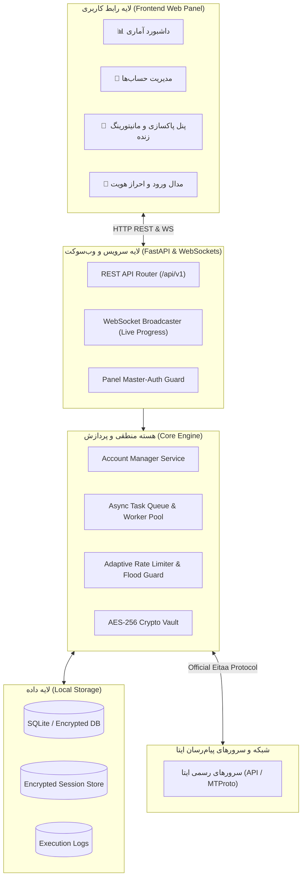
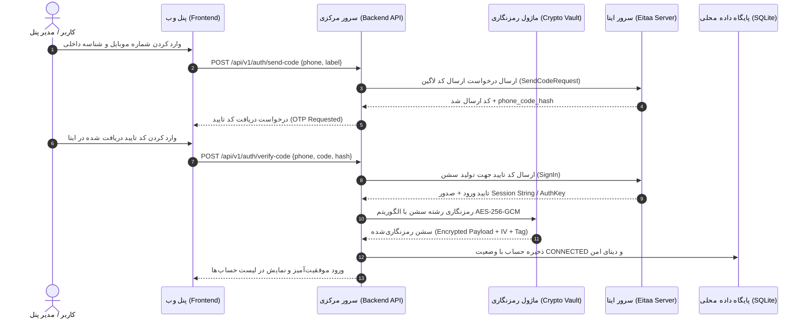

# مستند معماری سیستم (ARCHITECTURE.md)

این سند معماری کلی نرم‌افزار، لایه‌بندی ماژول‌ها، امنیت نشست‌ها و دیاگرام‌های جریان داده را تشریح می‌کند.

---

## ۱. نمای کلی معماری (High-Level Architecture)

سیستم بر پایه معماری سه لایه **کلاینت وب (Web Dashboard)**، **سرویس اصلی (Backend Core / API)** و **موتور ارتباط با ایتا (Eitaa Protocol & Worker Engine)** طراحی شده است.



---

## ۲. لایه‌بندی ماژول‌های پروژه

```
eitaa-cleaner-manager/
├── backend/
│   ├── app/
│   │   ├── main.py                  # نقطه ورودی FastAPI و وب‌سوکت
│   │   ├── config.py                # تنظیمات، متغیرهای محیطی و کلید مستر
│   │   ├── core/
│   │   │   ├── crypto.py            # توابع رمزنگاری AES-256-GCM و PBKDF2
│   │   │   ├── security.py          # احراز هویت ادمین پنل با JWT/Session
│   │   │   └── ratelimit.py         # مدیریت تاخیرهای امنیتی و صف
│   │   ├── database/
│   │   │   ├── connection.py        # اتصال Async به دیتابیس SQLite
│   │   │   └── models.py            # ساختار جداول (Account, Job, Log, etc.)
│   │   ├── eitaa/
│   │   │   ├── client.py            # کلاینت ایتا (مدیریت سوکت و پروتکل)
│   │   │   ├── auth_flow.py         # فرایند ارسال کد، دریافت OTP و ایجاد سشن
│   │   │   ├── dialogs.py           # واکشی کانال‌ها، گروه‌ها و سوپرگروه‌ها
│   │   │   └── actions.py           # متدهای ترک چت (Leave Channel/Group)
│   │   ├── engine/
│   │   │   ├── task_manager.py      # مدیریت صف پاکسازی، Pause و Resume
│   │   │   ├── worker.py            # واکرهای ناهمگام پردازش حساب‌ها
│   │   │   └── verifier.py          # بررسی مجدد صحت پاکسازی بعد از اتمام
│   │   └── api/
│   │       ├── v1/
│   │       │   ├── accounts.py      # مدیریت اکانت‌ها (CRUD + Healthcheck)
│   │       │   ├── auth.py          # فرایند چندمرحله‌ای لاگین اکانت ایتا
│   │       │   ├── clean.py         # شروع، توقف و ادامه تسک‌های پاکسازی
│   │       │   ├── stats.py         # داده‌های آماری داشبورد
│   │       │   └── logs.py          # گزارشات و تاریخچه ممیزی
│   │       └── websocket.py         # کنترلر کانکشن‌های وب‌سوکت لایو
│   └── requirements.txt
├── frontend/
│   ├── index.html                   # ساختار تک‌صفحه‌ای داشبورد (SPA)
│   ├── css/
│   │   ├── style.css                # استایل‌های مدرن Dark Mode و Glassmorphism
│   │   └── components.css           # کامپوننت‌های دکمه، جدول، مدال و پروگرس‌بار
│   ├── js/
│   │   ├── app.js                   # کنترلر اصلی برنامه
│   │   ├── api.js                   # کتابخانه فراخوانی REST API
│   │   ├── ws.js                    # هندلر وب‌سوکت برای آپدیت‌های زنده
│   │   ├── accounts.js              # رندر و مدیریت لیست حساب‌ها
│   │   └── cleaner.js               # مدیریت عملیات پاکسازی و لاگ زنده
│   └── assets/                      # آیکون‌ها و فونت‌های استاندارد
├── docs/                            # کلیه مستندات طراحی و راهنما
└── run.py                           # اسکریپت راه‌اندازی تک‌کلیک (One-click launcher)
```

---

## ۳. جریان احراز هویت و ذخیره سشن (Authentication Flow)

دیاگرام زیر نحوه اتصال حساب کاربری و ایزولاسیون کلیدهای سشن را نشان می‌دهد:



---

## ۴. مدل امنیت نشست‌ها و داده‌ها (Data Security & Cryptography)

1. **مدل رمزنگاری (Envelope Encryption):**
   - یک **Master Secret** از رمز عبور مدیر پنل با الگوریتم `PBKDF2-HMAC-SHA256` با ۱۰۰,۰۰۰ دور تکرار و سالت (Salt) تصادفی استخراج می‌شود.
   - هر سشن ایتا (`session_string` یا `auth_key`) قبل از ذخیره در دیتابیس با کلید استخراج‌شده و الگوریتم `AES-256-GCM` با Nonce تصادفی ۱۲ بایتی رمزگذاری می‌شود.
   - احراز اصالت داده توسط Authentication Tag تضمین شده و جلوی هرگونه دستکاری فایل را می‌گیرد.

2. **عدم ثبت اطلاعات حساس در لاگ‌ها:**
   - شماره تلفن‌ها در صورت نیاز به شکل Masked (مانند `0912***1234`) ذخیره می‌شوند.
   - کدهای OTP پس از پردازش بلافاصله از حافظه موقت پاک می‌شوند.
   - هیچ اطلاعاتی به هیچ سرور تله‌متری یا خارجی ارسال نمی‌شود.
