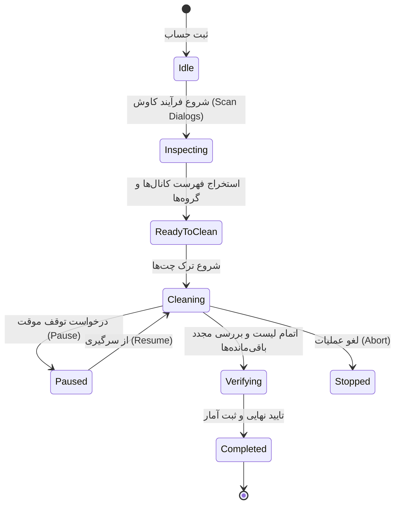
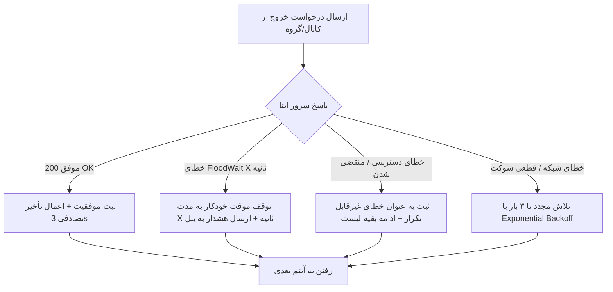

# مستند موتور پاکسازی و مدیریت همزمانی (CLEANING_ENGINE.md)

این سند جزییات عملکردی **موتور پاکسازی (Cleaning Engine)**، استراتژی خروج از چت‌ها، مدیریت صف پردازش همزمان حساب‌ها و مکانیزم‌های مقابله با محدودیت‌های سرور ایتا را تشریح می‌کند.

---

## ۱. چرخه حیات عملیات پاکسازی (Cleaning State Machine)

هر عملیات پاکسازی برای یک حساب مشخص مراحل زیر را به صورت اتمیک و کنترل‌شده طی می‌کند:



---

## ۲. گام‌های تفصیلی فرآیند پاکسازی

### گام اول: کاوش و دریافت فهرست اعتبارات (Discovery Phase)
1. اتصال کلاینت با استفاده از سشن رمزگشایی‌شده.
2. فراخوانی متد دریافت دیالوگ‌ها (`GetDialogsRequest`).
3. فیلتر کردن چت‌ها بر اساس نوع:
   - **کانال‌ها (Broadcast Channels)**
   - **سوپرگروه‌ها و مگاگروه‌ها (Supergroups)**
   - **گروه‌های عادی (Basic Groups)**
4. استخراج متادیتا شامل: شناسه چت (`peer_id`)، نام (`title`)، تعداد اعضا (`members_count`) و وضعیت دسترسی (`is_creator`, `is_admin`).
5. علامت‌گذاری دیالوگ‌هایی که حساب مالک آن است (`is_creator = true`) با برچسب محافظت‌شده جهت جلوگیری از ترک ناخواسته.

### گام دوم: فرآیند ترک چت‌ها (Execution Phase)
1. ایجاد لیست اولویت‌دار از مواردی که باید ترک شوند (کامل یا انتخاب دستی).
2. ارسال درخواست ترک (`LeaveChannelRequest` / `DeleteChatUserRequest`).
3. اعمال تأخیر انطباقی (Adaptive Delay) بین درخواست‌ها:
   - مقدار پیش‌فرض: `۲.۵ تا ۴.۵ ثانیه` تصادفی (Random Jitter).
   - در صورت حجم بالای کانال‌ها (> ۱۰۰ مورد): افزایش فاصله به صورت خودکار تا `۵ ثانیه`.
4. به‌روزرسانی درصد پیشرفت و ارسال رویداد از طریق WebSocket به داشبورد کاربر.

### گام سوم: صحه‌سنجی و تأیید نهایی (Post-Clean Verification)
1. پس از پایان چرخه ترک، یک بار دیگر فهرست کامل چت‌های حساب واکشی می‌شود.
2. مقایسه تعداد باقی‌مانده واقعی با لیست اولیه.
3. در صورتی که کانال یا گروهی به دلیل خطای سرور ترک نشده باشد:
   - وضعیت آن به `FAILED_REQUIRES_RETRY` تغییر می‌کند.
   - به هیچ عنوان جزء آمار ترک موفق شمرده نمی‌شود.
4. تولید گزارش تفصیلی نهایی و به‌روزرسانی رکورد حساب در پایگاه داده.

---

## ۳. سیاست‌های مقابله با محدودیت‌های سرور (Rate Limiting & Anti-Ban)

برای جلوگیری از مسدودسازی موقت یا جریمه‌های شبکه، موتور پاکسازی از الگوریتم‌های زیر بهره می‌برد:



### پارامترهای تنظیمی موتور امنیتی:
- **Max Concurrency (سقف اجرای همزمان):** حداکثر ۳ تا ۵ حساب کاربری به صورت کاملاً همزمان پردازش می‌شوند تا بار پردازشی و مصرف پهنای باند محلی کنترل شود. سایر حساب‌ها در صف پردازش قرار می‌گیرند.
- **FloodWait Protection:** در صورت دریافت خطای `FLOOD_WAIT_X`، سیستم زمان انتظار را استخراج کرده، تایمر شمارش معکوس را در پنل فعال می‌کند و پس از اتمام زمان، به صورت خودکار کار را ادامه می‌دهد.
- **Daily Quota Warning:** در صورتی که تعداد درخواست‌های یک حساب در یک روز بیش از حد مجاز سرور باشد، سیستم به کاربر هشدار داده و اجازه می‌دهد باقی موارد برای ساعات بعد زمان‌بندی شوند.

---

## ۴. ساختار کنترل مکث، ادامه و بازیابی (Pause / Resume Engine)

وضعیت هر تسک با ساختار زیر در حافظه و دیتابیس همگام است:

```json
{
  "job_id": "job_98a72b",
  "account_id": 14,
  "state": "PAUSED",
  "total_items": 120,
  "processed_items": 45,
  "successful_items": 42,
  "failed_items": 3,
  "pending_dialog_ids": [1029384, 1029385, 1029386],
  "started_at": "2026-10-08T14:30:00Z",
  "paused_at": "2026-10-08T14:33:12Z"
}
```

با زدن دکمه **Resume** در پنل، کارگر پردازشی مستقیماً آرایه `pending_dialog_ids` را ادامه داده و نیازی به اسکن مجدد کل کانال‌ها نخواهد بود.
