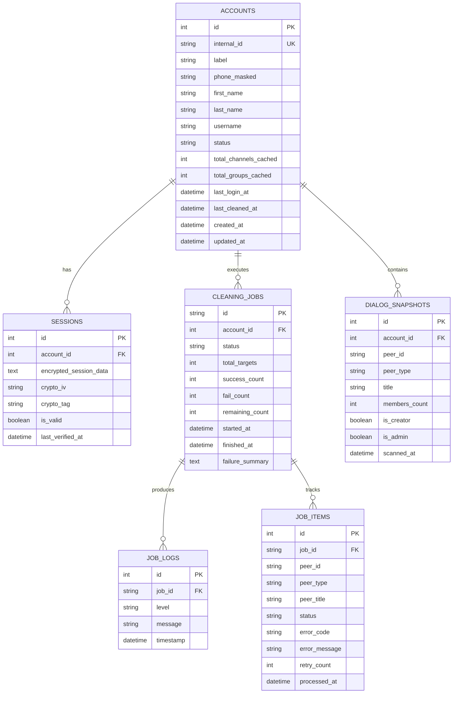

# مستند ساختار پایگاه‌داده (DATABASE_SCHEMA.md)

این سند ساختار جداول پایگاه داده محلی سیستم (SQLite / SQLAlchemy) را به همراه روابط، فیلدهای رمزنگاری‌شده و ایندکس‌ها مشخص می‌کند.

---

## ۱. دیاگرام موجودیت‌ها و روابط (ERD)

---

## ۲. مشخصات تفصیلی جداول (Table Definitions)

### جدول `accounts` (حساب‌های کاربری)
| نام ستون | نوع داده | توضیحات |
| :--- | :--- | :--- |
| `id` | INTEGER PRIMARY KEY | شناسه عددی اتوماتیک |
| `internal_id` | VARCHAR(50) UNIQUE | شناسه داخلی سیستم (مثلاً `ACC-001`) |
| `label` | VARCHAR(100) | برچسب سفارشی داده‌شده توسط کاربر (اختیاری) |
| `phone_masked` | VARCHAR(20) | شماره تلفن ماسک‌شده (جهت حفظ حریم خصوصی) |
| `first_name` | VARCHAR(100) | نام در پروفایل ایتا |
| `last_name` | VARCHAR(100) | نام خانوادگی در پروفایل ایتا |
| `username` | VARCHAR(100) | نام کاربری ایتا (اختیاری) |
| `status` | VARCHAR(30) | وضعیت: `CONNECTED`, `NEEDS_REAUTH`, `BUSY`, `RESTRICTED` |
| `total_channels_cached` | INTEGER | تعداد کانال‌ها در آخرین اسکن |
| `total_groups_cached` | INTEGER | تعداد گروه‌ها در آخرین اسکن |
| `last_login_at` | DATETIME | تاریخ آخرین اتصال موفق |
| `last_cleaned_at` | DATETIME | تاریخ آخرین عملیات پاکسازی موفق |
| `created_at` | DATETIME | تاریخ اضافه شدن حساب به پنل |

---

### جدول `sessions` (نشست‌های رمزنگاری‌شده)
> [!IMPORTANT]
> داده‌های این جدول با الگوریتم AES-256-GCM رمزگذاری می‌شوند و کلید در حافظه امن مشتق‌شده از پسورد پنل نگهداری می‌شود.

| نام ستون | نوع داده | توضیحات |
| :--- | :--- | :--- |
| `id` | INTEGER PRIMARY KEY | شناسه یکتای نشست |
| `account_id` | INTEGER REFERENCES accounts(id) | شناسه حساب مرتبط |
| `encrypted_session_data` | TEXT | رشته احراز هویت رمزنگاری‌شده (Base64) |
| `crypto_iv` | VARCHAR(32) | بردار مقداردهی اولیه (Initialization Vector) |
| `crypto_tag` | VARCHAR(32) | کد اعتبارسنجی احراز اصالت رمزنگاری (GCM Auth Tag) |
| `is_valid` | BOOLEAN | معتبر بودن نشست |
| `last_verified_at` | DATETIME | آخرین زمان تست سلامت نشست |

---

### جدول `cleaning_jobs` (تسک‌های عملیات پاکسازی)
| نام ستون | نوع داده | توضیحات |
| :--- | :--- | :--- |
| `id` | VARCHAR(64) PRIMARY KEY | شناسه یکتای تسک پاکسازی (UUID/NanoID) |
| `account_id` | INTEGER REFERENCES accounts(id) | حساب تحت پردازش |
| `status` | VARCHAR(30) | `PENDING`, `RUNNING`, `PAUSED`, `COMPLETED`, `FAILED`, `ABORTED` |
| `total_targets` | INTEGER | مجموع آیتم‌های مشخص‌شده برای ترک |
| `success_count` | INTEGER | تعداد ترک‌های موفق |
| `fail_count` | INTEGER | تعداد ترک‌های با خطا |
| `remaining_count` | INTEGER | تعداد موارد باقی‌مانده در صف |
| `started_at` | DATETIME | زمان آغاز تسک |
| `finished_at` | DATETIME | زمان پایان تسک |
| `failure_summary` | TEXT (JSON) | خلاصه دلایل خطاها و پیشنهادات بررسی مجدد |

---

### جدول `job_items` (وضعیت تک‌تک دیالوگ‌ها در حین پاکسازی)
| نام ستون | نوع داده | توضیحات |
| :--- | :--- | :--- |
| `id` | INTEGER PRIMARY KEY | شناسه ردیف |
| `job_id` | VARCHAR(64) REFERENCES cleaning_jobs(id) | شناسه تسک مربوطه |
| `peer_id` | VARCHAR(50) | شناسه کانال یا گروه در ایتا |
| `peer_type` | VARCHAR(20) | `channel`, `supergroup`, `basic_group` |
| `peer_title` | VARCHAR(255) | نام کانال یا گروه |
| `status` | VARCHAR(20) | `QUEUED`, `LEFT_SUCCESS`, `ERROR`, `SKIPPED_ADMIN` |
| `error_code` | VARCHAR(50) | کد خطای برگشتی از سرور ایتا (در صورت وجود) |
| `error_message` | TEXT | شرح پیام خطا |
| `retry_count` | INTEGER | تعداد دفعات تلاش مجدد |
| `processed_at` | DATETIME | زمان اتمام پردازش این آیتم |
